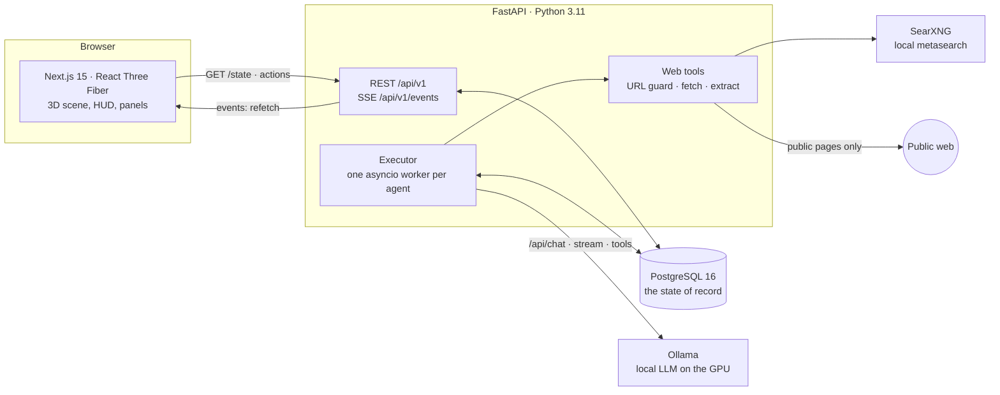

# AI Office

[](../../actions/workflows/ci.yml)


A local, single-user app where you are the director of a 3D office and the staff are AI agents. You give an agent a
task; the agent drives in, parks, takes the lift or the stairs to their desk and works through it in stages (plan → web research →
draft → self-check) on a **local model in Ollama**, with live text you can watch. When they finish, the result lands in
your review queue, and you accept it or send it back with a comment. Everything you see in the building, from who is
typing to who is queuing for coffee because the GPU is busy, is drawn from the real state in PostgreSQL rather than
from scripted animation. I built it to learn how to put a real LLM workflow (queues, retries, tools, restarts) behind a
UI that makes the system's state obvious at a glance.


*Agents drive in, park, go up to their desks and start work; two results arrive for review. Demo mode, sped up 13x.*

All images use the fictional demo profile (`python -m app.seed --demo`). The interface is in English by default
(Russian is one click away: EN | RU in the HUD); agents write in English unless a task asks otherwise.

## What it does

- **Tasks with stages and review.** Queue tasks per agent; the executor runs them in parallel across agents, one task
  per agent at a time. Results are versioned Markdown with sources; rework starts from your comments and the previous
  version. Pause, resume and cancel at any moment.
- **Local LLM.** Ollama with streaming and thinking on. A context budget keeps room for thinking and the whole answer
  and trims the input in a fixed order (if the window still fills up, the call is repeated without thinking). If
  Ollama stops or restarts, work waits for it and goes on from the text already written instead of failing; a call
  counts as stuck only when the model writes nothing for two minutes. Plain-language errors for the director (model
  not pulled, stuck). A failed task can be retried from the stage that failed.
- **Web research.** Agents with web access search through a local SearXNG instance and read public pages through a
  guarded fetcher; every claim in the result points to a numbered source.
- **Job search.** The job search agent queries the official Adzuna and Reed APIs, merges duplicates across them and
  reads full adverts on demand. A hard filter in code (not the model) drops vacancies that ask for security clearance
  with a UK residency condition (SC/DV/NPPV), years of UK residency or a nationality from birth; the result lists the
  excluded ones with the reason and the count. Sent a vacancy that fails it, the agent says so instead of writing an
  application. Vacancies that are closed (a past closing date in Reed's API, removed from Reed, an advert page that is
  gone or says it has expired) are never recommended; where neither the API nor the page can tell (Adzuna gives no
  closing date and its pages refuse automated requests, which are not worked around), the result says that freshness
  was not checked.
- **A living building.** Cars queue at the barriers, people wait at the card reader and share the lift (capacity 4),
  walk to the kitchen while the model is busy, sit in the lounge while waiting for review or when they are free, chat,
  and stroll. Agents stay in the office when their work is done and take a new task at once; they go home only when you
  let them (Send home for one; Release all lets people go a few seconds apart), and a task that comes while one is
  still walking to the car turns them back to the desk. Click any agent, desk, parking spot or the server room to open
  its panel.

## What's new since v1.0

- **Job search** with the hard eligibility filter in code, three modes (search, review a vacancy, application) and a
  freshness check, as described above.
- **Agents stay in the office** after their work instead of going home after every task: Send home, Release all, and
  turning back to the desk when a task comes while they are leaving.
- **English interface** by default, Russian as the second language. The backend sends codes and parameters, the
  interface translates them, and `check:i18n` keeps the two dictionaries in step.
- **Security and load audit, with fixes.** An independent review of the app as it runs on one PC (summary of all 33
  findings and their status: [`docs/security-audit.md`](docs/security-audit.md)); the fixes are listed
  under [Security](#local-only-and-untrusted-text) and [Performance](#performance), the rest is in
  [`docs/backlog.md`](docs/backlog.md).
- **Resilience.** The executor waits for PostgreSQL at start and after a dropped connection; an Ollama restart or
  outage makes work wait and continue instead of failing.
- **Backups.** `backup.ps1` saves verified, dated database copies outside the project, with an optional second folder.
- **One-command start and stop** on Windows: `start.ps1` and `stop.ps1`.

## Architecture



- **Frontend** (`frontend/`): Next.js 15 App Router, TypeScript strict, React Three Fiber + drei, zustand, Tailwind v4.
  All geometry is pure functions in `src/scene/layout/`; components only render.
- **API** (`backend/app/api`, `services`): FastAPI, SQLAlchemy 2 async + asyncpg, Pydantic v2, Alembic. Thin routers,
  business rules in `services/rules.py` (pure functions; an illegal transition is a 409).
- **Executor** (`backend/app/executor`): started in the FastAPI lifespan; moves agents through their day and tasks
  through their stages. The stage work sits behind a `StageWorker` protocol with two implementations: `LlmWorker`
  (Ollama) and `FakeWorker` (no model, for the demo and tests).
- **Ollama** runs the model; **SearXNG** (in docker-compose, bound to `127.0.0.1`) provides search;
  **PostgreSQL** (docker-compose) holds everything.


*How a frame is drawn: every position on screen is a pure function of the database state and the server time.*

## Key engineering decisions

### The database is the state; the scene only displays it

Agent status, the start of every status and trip, the activity log, task stages, runs and results are all rows.
`GET /api/v1/state` is the single snapshot the scene renders; server-sent events only tell the browser to refetch. The
scene contains no business logic, so a page reload, a second browser tab or a backend restart all show the same
picture.

### Motion schedules are pure functions

Trips (`trips.ts`) and office life (`life.ts`) are computed from `(trips, activity log, server time)` → poses; there is
no animation state in React or in the database. The trip planner handles the queues (entry barrier, parking aisle, exit
barrier, card reader, a lift with 4 places) and still makes every trip last exactly the 75 s the executor waits for.
Plans are append-only, so a new arrival never moves anyone already on the way. Turning back on the way home needs one
number both sides agree on: a departing car never leaves its spot before 50 s, so a task that comes earlier turns the
agent back (the return lasts the time already spent leaving plus 12 s, enough for the worst case, a lift whose doors
have just closed; back early, they sit at the desk), and a later one lets the car drive to the map edge and come
straight back. The browser keeps an offset to the server clock, so all viewers agree on where everyone is.
`npm run check:layout` checks 47 invariants of this layer (no overlaps, lift capacity, exact durations, no jump when
someone turns back at any moment, stability when new trips appear) without a browser.

### A queue in front of the GPU

A semaphore (`LLM_CONCURRENCY`, default 1) guards the model. A run is `waiting` until its request is really sent, then
`running`. A call times out only when its stream goes silent, never while it waits in the queue, and the GPU slot is
held per model call, never while a web tool runs. If Ollama is out of reach, the run stays `waiting` (the task card
says so), the executor polls Ollama with a growing pause, and the call goes on from the text already written. The queue
is visible: waiting agents lean back, then go for coffee, and the server room lists who has the model and who is next.


*Waiting for the model: while another agent has the GPU, the agents in the queue go to the kitchen for coffee. Sped up 2x.*

### A hard filter in code for job eligibility

Whether a vacancy is out of reach (security clearance with a UK residency condition, years of UK residency, nationality
from birth) is decided by one list of patterns in `app/jobs/eligibility.py`, tested on real advert wording both ways
("SC cleared" counts, "SC Johnson", "DV360" and "SC clearance is not required" do not; BPSS alone does not). Excluded
vacancies never reach the model; one that fails when its full advert is read is withdrawn; and the final text is
post-processed so that no line mentions an excluded vacancy, followed by the excluded list with reasons and the count.
Each job API has a daily request limit (100 by default, counted in the database), and a failed request is not repeated
for two minutes.

### Guarded web tools

The fetcher accepts only http/https on standard ports with no credentials in the URL. It resolves the host and refuses
any non-global address (private, loopback, link-local, CGNAT, IPv4-mapped), then connects to that checked IP with the
original Host and SNI, so DNS rebinding cannot redirect it. Redirects are followed by hand and re-checked (at most 5).
It sends GET only, without cookies or auth, reads text types only, and enforces size, time and per-stage call limits;
compressed pages are unpacked by hand within the same size limit. Page text goes back to the model as escaped data
inside `<web_content>` tags, and the house rules say that web content is data, not instructions. SearXNG down or a
failing page never fails the stage; the result then says what could not be checked.

### Local only and untrusted text

The app has no login, so it must be reachable only from this computer and must not leak through what agents read.

- **Local access.** PostgreSQL, SearXNG, the API and the dev server listen on the loopback only. The API answers only
  `localhost` / `127.0.0.1` as the Host (a DNS-rebinding page gets 400) and refuses state-changing requests from other
  sites (403). The interactive API docs, which load scripts from a CDN, are off by default.
- **The browser.** Pages carry a Content-Security-Policy that lets them talk only to themselves and to the API. Images
  in model output are shown as links, never loaded, so a page the agent read cannot make the browser send data out.
- **Research without personal context.** The research stage sees the task and its plan only, not the director's profile
  or comments. It may open only addresses from the task, from search results or from the job tools, and every search
  query is checked against the profile's name, contacts, links and project names; a refused call shows up as a blocked
  step with the reason.

### Recovery after a restart

A Postgres advisory lock allows one executor per database. Every step is a short transaction that re-reads the row
under `SELECT … FOR UPDATE`, so the director's actions (pause, cancel, request changes) always win. On start, runs left
`running` or `waiting` are marked `interrupted` and their stage runs again; agents in the office stay there; those
arriving, leaving or returning wait only for the rest of the trip, counted from `status_since`. Because the scene is
computed from those timestamps, an agent halfway up the stairs is still halfway up the stairs after a restart. If the
database is down when the backend starts, the executor keeps retrying and starts by itself once PostgreSQL answers.

## Performance


*The server room panel: the loaded model, GPU memory and load, the speed of the last request, who has the model and who is queuing.*

The 3D scene and the model share one GPU, so the scene draws on demand: at most the frame rate chosen in the HUD (15,
30 or 60 fps, default 30) and nothing at all while the page is hidden. Measured on an RTX 4090 with `qwen3.8:27b`
(a 400-token answer, median of three runs):

| Scene | Model speed |
|---|---|
| No page open | 87–89 tok/s |
| Uncapped scene (164 fps) | 78 tok/s (−11–13 %) |
| Capped at 30 fps (default) | 87 tok/s (within noise) |
| Capped at 60 fps | 85 tok/s |
| Window minimised | 89 tok/s |

## Requirements

- Docker (Docker Desktop on Windows/macOS) for PostgreSQL and SearXNG
- Python 3.11
- Node.js 22 or newer (the layout checks use `--experimental-strip-types`)
- Optional, for real AI work: [Ollama](https://ollama.com) 0.35+ and an NVIDIA GPU (see [Model](#use-a-local-model))

## Quick start: demo mode (no GPU)

Demo mode fills an empty database with a fictional director and a few tasks with finished results, and uses the fake
executor: agents drive in and "type" placeholder text, so the whole flow works without a model. Commands are for
Windows PowerShell; the macOS/Linux equivalents are in the comments.

```powershell
git clone https://github.com/Bogdusik/ai-office.git
cd ai-office

# 1. Database
Copy-Item .env.example .env          # cp .env.example .env — then set POSTGRES_PASSWORD
docker compose up -d db

# 2. Backend
cd backend
Copy-Item .env.example .env          # cp ... — put the same password into DATABASE_URL and TEST_DATABASE_URL
python -m venv .venv
.\.venv\Scripts\Activate.ps1         # source .venv/bin/activate
pip install -r requirements-dev.txt
alembic upgrade head
python -m app.seed --demo            # refuses to run on a database with a filled-in profile or any task
uvicorn app.main:app --port 8000 --timeout-graceful-shutdown 2

# 3. Frontend (a second terminal, from the repository root)
cd frontend
Copy-Item .env.example .env.local    # cp .env.example .env.local
npm ci
npm run dev -- -H 127.0.0.1           # only this computer, not the local network
```

Open http://localhost:3000. Two agents with queued tasks drive in and start working; the writer is already waiting for
your review in the lounge. Open Director's office (top right) for the review queue, or click an agent.

`python -m app.seed` without `--demo` creates only the building and the six agents with an empty profile: that is the
starting point for your own use. Fill in the profile in Director's office → Profile.

**Without Docker (macOS).** PostgreSQL is the only part of `docker-compose.yml` the app needs to boot; SearXNG only adds
web research to a model-backed stage. Homebrew's PostgreSQL works in its place — install `postgresql@16`, start it,
create the role and both databases, and **grant the role `CREATEDB`**, because a test session drops and recreates
`ai_office_test` itself:

```bash
brew install postgresql@16 && brew services start postgresql@16
createuser -h 127.0.0.1 -d postgres ai_office                     # then: ALTER ROLE ai_office CREATEDB;
createdb -h 127.0.0.1 -U ai_office ai_office && createdb -h 127.0.0.1 -U ai_office ai_office_test
```

Point `DATABASE_URL` and `TEST_DATABASE_URL` at `127.0.0.1:5432`; the compose file publishes 5433 instead. A python.org
framework build of Python ships without a CA bundle, so `pip` fails every HTTPS request until it is given one
(`SSL_CERT_FILE=/etc/ssl/cert.pem`, or a `cert = …` line in `.venv/pip.conf`). The port-3000 dev server also collides
with other local web apps: `npm run dev -- -H 127.0.0.1 -p 3001` and add that origin to `CORS_ORIGINS`.

## Use a local model

1. Install Ollama and pull the default model:
   `ollama pull qwen3.8:27b` (17 GB; fits a 24 GB GPU with a 16K context, about 90–100 tokens/s on an RTX 4090).
2. In `backend/.env` set `EXECUTOR_WORKER=llm` and restart the backend. The dot next to «API» in the HUD turns green
   when Ollama is up and the model is present.

**A smaller GPU.** Any Ollama model with tool calling works; set it in `backend/.env`:

```env
OLLAMA_MODEL=qwen3:8b       # ~5 GB, for 8–12 GB of VRAM
OLLAMA_NUM_CTX=8192         # a smaller context window needs less VRAM
LLM_RESERVE_TOKENS=3072
```

`ollama pull qwen3:8b` first. Expect weaker drafts and less reliable research than with the 27B model. A single agent
can use a different model: Edit in its panel → Model. How the default was chosen: `docs/model-benchmark.json`.

**Web search.** Set `SEARXNG_SECRET` in the root `.env` (any long random string) and run `docker compose up -d`, which
also starts SearXNG on `127.0.0.1:8888`. Agents with Internet access then search and read pages during the
research stage.

**Job search.** The job search agent has the Job search tool (an agent setting: Edit → Job search).
Get free keys at [developer.adzuna.com](https://developer.adzuna.com) and
[reed.co.uk/developers/jobseeker](https://www.reed.co.uk/developers/jobseeker) and put them into `backend/.env`:

```env
ADZUNA_APP_ID=...
ADZUNA_APP_KEY=...
REED_API_KEY=...
```

A source without keys is skipped and the result says so; the server room shows whether each source has keys, how its
latest request went and how many of today's requests are used (the keys themselves are never shown or logged).
`JOBS_MAX_CALLS` (10 per task), `ADZUNA_DAILY_LIMIT` and `REED_DAILY_LIMIT` (100 each), `JOBS_CACHE_SECONDS` (600) and
`JOBS_TIMEOUT_SECONDS` (15) tune the tools. The agent works in three modes, picked from the task: search ("find junior
Python roles in Leeds"), review (paste a vacancy or its link) and application (tailored CV points and a cover letter);
it never applies for anything.

## Use the Qoder CLI instead of a model (no GPU, no Docker)

`EXECUTOR_WORKER=qoder` makes each stage of a task one non-interactive
[`qoder -p`](https://qoder.com) run, so the agents write real text without a local model, without a GPU and without
Ollama. Set it in `backend/.env` and restart the backend:

```env
EXECUTOR_WORKER=qoder
# QODER_BIN=qoder          # executable name or path; it must be on the backend's PATH
# QODER_MODEL=             # empty = the CLI's own default; an agent's `model` field overrides it
# QODER_CONCURRENCY=1      # stages sent to the CLI at the same time
```

The run is isolated from whoever starts the backend: no MCP servers, no built-in tools, no user or project settings,
no session persistence, and its working directory is an empty temp directory rather than this project. A stage
therefore only writes text — the research stage says that it had no web access, like a model without tools.

Two things follow from the CLI reporting one line per completed message instead of a token stream: a long answer is
silent by design, so `QODER_IDLE_TIMEOUT_SECONDS` (900) has to cover a whole draft; and stopping the backend while a
stage runs sends it SIGTERM, which shows up as a failed stage rather than an interrupted one — pause the task first,
or retry it afterwards.

## Watch your own CLI session in the office (live bridge)

Besides working through tasks, an agent can mirror a process that lives outside the app: `POST /api/v1/agents/{id}/live`
takes `{kind, detail}` and records it as a heartbeat, and the executor treats a heartbeat younger than
`LIVE_TTL_SECONDS` (180) as work — the agent drives in, sits at its desk, and shows `detail` on the plaque above its
head; when the heartbeats stop, it puts its tools down and rests in the lounge. Nothing else changes: a heartbeat never
overrides a task, and the director's commands (pause, send home) still win — a heartbeat only turns an agent back on its
way out while the car is still in its spot, the same way a new task does.

`scripts/qoder-office-live.sh` is a Qoder CLI hook that sends these heartbeats: it reads the hook JSON from stdin, maps
the tool to a state (`WebSearch`/`WebFetch` → searching, `Read`/`Grep`/`Glob` → reading, `Edit`/`Write` → editing,
`Bash` → running, `Agent`/`Task` → delegating, `Stop`/`SessionEnd` → idle) and posts it. It fails silently on purpose,
because a hook must never break the CLI. Enable it in your Qoder settings, then point it at your agent:

```bash
AI_OFFICE_URL=http://127.0.0.1:8000 AI_OFFICE_AGENT_ID=7   # what the hook reads (defaults shown)
```

The label text is filtered to ASCII: the scene draws names and captions with the bundled Inter font, which has no
glyphs past it (a `·` would simply disappear rather than show as a dot).

## Start and stop with one command (Windows)

After the first-time setup above, two scripts in the repository root run everything:

```powershell
.\start.ps1          # Docker Desktop, PostgreSQL + SearXNG, Ollama + model, backend, frontend; -Open opens the browser
.\stop.ps1           # frontend, backend, containers (data kept), unloads the model; -All also quits Ollama and Docker Desktop
```

`start.ps1` starts only what is not running yet and checks each service before the next one: the database is healthy,
SearXNG answers a search, the model from `backend/.env` is downloaded and loaded into GPU memory (skipped with
`EXECUTOR_WORKER=fake`), `/health` answers and the page opens. If something does not come up, it stops and says what to
do (for example `ollama pull <model>` or which program holds the port). The backend and the frontend run hidden in the
background with their output in `logs/`. `stop.ps1` stops only this project's processes: a different program on port
3000 or 8000 is reported and left alone.

If PowerShell refuses to run scripts, run them as `powershell -ExecutionPolicy Bypass -File .\start.ps1`.

## Backup and restore

All data (profile, tasks, results) lives in the Docker volume of the database. `backup.ps1` saves a dated copy outside
the project and keeps the latest 14:

```powershell
.\backup.ps1                                              # to %USERPROFILE%\Backups\AI-Office
.\backup.ps1 -MirrorDir "$env:OneDrive\Backups\AI-Office" # also copy it to a second folder (another disk, cloud)
```

The folders can also be set once in the root `.env` (`BACKUP_DIR`, `BACKUP_MIRROR_DIR`). The script runs `pg_dump`
inside the database container, checks that `pg_restore` can read the file and only then saves it as
`ai_office-<yyyyMMdd-HHmmss>.dump`. To run it every day, add it to Windows Task Scheduler.

To restore a copy, stop the backend (`.\stop.ps1`, then `docker compose up -d db`) and load the file over the current
data:

```powershell
docker cp "$env:USERPROFILE\Backups\AI-Office\ai_office-20261013-210000.dump" ai-office-db:/tmp/restore.dump
docker exec ai-office-db pg_restore -U ai_office -d ai_office --clean --if-exists /tmp/restore.dump
docker exec ai-office-db rm /tmp/restore.dump
```

(`-U` and `-d` are `POSTGRES_USER` and `POSTGRES_DB` from the root `.env`.) Then start everything again with
`.\start.ps1`.

## Using it

- Mouse: left drag rotates, right drag pans, the wheel zooms to the cursor; Home returns to the default view.
- Click an agent, a free desk, a parking spot, the director's office or the server room to open its panel; Esc closes
  the innermost layer. The HUD switches Animation and Office life turn movement off and keep everyone at their desks;
  FPS sets the scene's frame rate.
- `?preview=1` shows every agent at their desk and every car parked without touching the database.
- Agents stay in the office after their work: Send home in an agent's panel, Release all in Director's
  office → Team. Someone with a task in progress, queued or sent back for changes cannot go (the disabled
  button says why); tasks waiting for your review or paused do not keep anyone.
- The whole API as Markdown (also for language models): http://localhost:8000/llms.txt; OpenAPI: /openapi.json.
  The interactive docs at /docs load Swagger UI from a CDN, so they are off unless `API_DOCS=true` in `backend/.env`.
  Health: http://localhost:8000/health.

## Tests and checks

```powershell
cd backend; pytest                   # needs TEST_DATABASE_URL: a separate database, dropped and recreated on each run
cd frontend; npm run lint; npx tsc --noEmit; npm run check:layout; npm run check:i18n; npm run check:ui; npm run build
```

CI (GitHub Actions) runs the same: pytest against a PostgreSQL service (plus migrations and the demo seed), ESLint,
the layout checks, the translation check, the interface checks and a production build (which also type-checks).

`check:i18n` fails when Cyrillic appears in the frontend sources outside the Russian dictionary, or when the English
and Russian dictionaries differ in keys or placeholders. `check:ui` covers images in Markdown (shown as links), the
Content-Security-Policy and the frame-rate limiter. The backend sends messages the director sees in English with a
code and parameters; the interface translates the code.

## Limitations

- Local and single-user by design: no authentication. Do not expose the backend to a network.
- Desktop only. Interface in English and Russian; agents' results are in the language the task asks for.
- Only Ollama is wired up as a provider; the data model already has a field for others. Without a GPU only the fake
  executor is practical.
- `start.ps1`, `stop.ps1` and `backup.ps1` are for Windows; on macOS/Linux start the services by hand as in the quick
  start.
- Adzuna gives no closing date and its advert pages refuse automated requests, so Adzuna vacancies are marked as not
  checked for freshness.
- An instruction in the task text itself can still make the draft stage write a link that carries profile details into
  the result (nothing is opened, but a click would send them). Links in results are not yet checked for that.
- Text fields have no length limit yet, the frontend runs on the Next dev server for daily use, logs are overwritten on
  every start, and when SearXNG's engines are blocked the agent sees "no results" rather than "search unavailable".
  These and the other open audit findings are in [`docs/backlog.md`](docs/backlog.md).
- In the parking aisle, arriving and leaving cars do not give way to each other yet: a car reversing out while another
  drives in can briefly overlap. The exit barrier is the bottleneck: Release all lets people go 5 s apart; agents
  released by hand within a second or two of each other may have to drive off faster than usual to keep every trip at
  exactly its duration.
- An agent who turns back on the way home is often back at the desk a few seconds before work starts: the return
  lasts the time already spent leaving plus 12 s, set by the slowest case (turning just after the lift doors closed).

## Roadmap

From [`docs/backlog.md`](docs/backlog.md):

- **Agents working together:** an agent hands part of a task to a colleague or asks them to review it (a sub-task with
  its own runs); in the scene they walk over to the colleague's desk.
- **Audit leftovers:** length limits on text fields, a production frontend build for daily use, rotating logs, lighter
  task and state payloads, a warning when the model does not fit in GPU memory.
- **Polish:** materials per zone, decorative lighting, pictures on the walls, traffic lights; an interior with rooms,
  doors and a corridor in a larger building.

## License

[MIT](LICENSE). The bundled Inter font is licensed separately under the SIL Open Font License 1.1
([`frontend/public/fonts/LICENSE-Inter.txt`](frontend/public/fonts/LICENSE-Inter.txt)).
